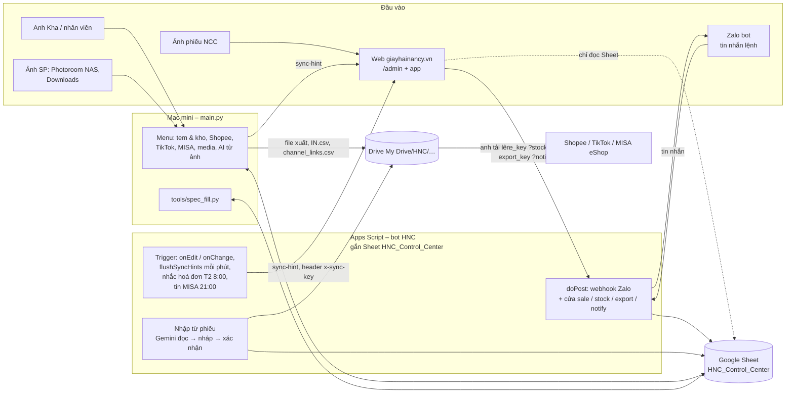

# Kiến trúc HNC_Master (HNC Control Center)
Cập nhật 16/10/2026 (Thực thi – HNC_Master). Đổi cấu trúc thì sửa file này cùng commit. Chi tiết bot: `zalo_bot/README.md`. Trạng thái + việc sau: mục cuối file này (bản cũ ở `docs/luu_tru/`).

## Sơ đồ

## Chạy ở đâu
| Phần | Nơi chạy | Cách chạy |
|---|---|---|
| Bot HNC (`zalo_bot/Code.gs`) | Google Apps Script, gắn Sheet | Web App `/exec` (1 bản triển khai, link giữ nguyên). Cập nhật: `commands/bot_deploy.command` (test → `clasp push` → cập nhật đúng bản triển khai) |
| Trigger bot | Apps Script | `onSheetEditHint` (onEdit), `onSheetChangeHint` (onChange), `flushSyncHints` mỗi 1 phút, `weeklyInvoiceReminder` thứ Hai 8:00, `dailyMisaSummary` 21:00 (tin MISA cuối ngày theo hộ). Tạo bằng hàm `setupChangeTrigger` |
| Menu HNC (`main.py`) | Mac mini, `venv` | Bấm đúp `run.command`. Không có lịch tự chạy |
| `tools/spec_fill.py` | Mac mini | `plan` / `ai` / `apply` (điền thông số còn trống trong SANPHAM) |
| Media | NAS `/Volumes/Media/HNC_Master/` | Menu 5 gom ảnh từ Photoroom (NAS) và Downloads |

Menu main.py: 1 Tem & kho (in tem `IN.csv`, đồng bộ SKU NHAP → 2 kho), 2 Shopee (đăng mới, cập nhật giá / tồn), 3 TikTok (đăng mới, cập nhật), 4 MISA (danh mục cha – con, nhập kho mua hàng), 5 Media, 6 AI nhập sản phẩm từ ảnh (Gemini). Các tác vụ web cũ (WEB_PRODUCTS / WEB_STOCK, cào ảnh) đang ẩn.

## Đọc / ghi gì
**Sheet `HNC_Control_Center`** (đọc / ghi theo tên cột; SANPHAM tên cột ở **hàng 2**, các tab khác hàng 1):
- `SANPHAM`: danh mục SP. Bot thêm dòng mã mới từ phiếu, `bo_sung_sp`, cờ `shopee_upload` / `tiktok_upload` (mark_exported). main.py ghi cờ `*_upload`, `get_images`, ảnh.
- `KHO15E`, `KHOY3C`: tồn = `opening_quantity` + NHAP − XUAT − BAN (công thức SUMIF theo FSKU). Bot / main.py thêm dòng SKU mới, bot sửa `product_location`.
- `NHAP` (hàng 2 là tiêu đề kỹ thuật), `XUAT`, `BAN` (`channel`, `seller`, `chu_hang`): bot ghi; main.py đánh dấu `web_stock`, `web_label`, `misa_stock`, `kho_sync`.
- Ký gửi giữa 2 hộ (18/10): cột `KHO15E.cua_Y3C`, `KHOY3C.cua_15E` (thay tab KYGUI, nay là `KYGUI_cu`); `BAN.ky_gui_tru` đánh dấu dòng đã trừ; bot soát dòng gõ tay mỗi 5 phút.
- `SUB`: ngành hàng, NCC (Mã / Tên đối tượng, thuế), % giá sàn, kích thước. Chỉ đọc. Cột `loai_dong` (19/10): `nganh` = ngành của tiệm (44 dòng), `shopee` = ngành Shopee lẻ "1000xx - …" chỉ để tra mã (96 dòng); danh sách ngành (bot `productCategories_`, main.py `load_sub_dictionary`, form web) bỏ dòng `shopee`.
- `META` (key / value / updated_at): `shopee_last_update`, `tiktok_last_update`.

**Drive** (`hnc_paths.py` khai 1 chỗ):
- `My Drive/HNC/He_thong/` (cũ: `Spark/HNC_Master`): `HNC_Templates` (tpl_*), `HNC_Exported_Files` (file xuất, `channel_links.csv`, SPEC_FILL_AI_*), `Outputs`. Không thấy thì main.py dừng, không dùng thư mục local.
- `My Drive/IN Mini Code/`: `IN.csv` / `IN_<kho>.csv` (P-touch dự phòng), `IN_BU_nhat_ky.csv`. In tự động QL-700: bot ghi lệnh vào tab ẩn `in_tem_lenh` → Mac mini (launchd `vn.giayhainancy.hnc.intem` → `tools/label_print.py`, chạy liên tục, đọc mỗi 4 giây; cài bằng `tools/launchd/cai_in_tem.sh`) in qua USB, dựng tem `tools/label_render.py` (dùng chung với main.py task 10), tự ghi `web_label` + ô `ket_qua`. Cần: QL-700 đèn nguồn sáng, cắm USB, đèn Editor Lite tắt. In liền cả đợt, cắt 1 lần cuối (`CAT`).
- `My Drive/HNC/Thue/2026/`: `Hoá đơn 2026` (bot đọc theo ID `INVOICE_FOLDER_ID`), `Phiếu mua hàng` (bot ghi theo ID `PN_FOLDER_ID`: `Chưa chia/<NCC>/`, rồi `<hộ>/<NCC>/`).

## Cửa của bot (doPost)
| Tham số URL | Ai gọi | Việc |
|---|---|---|
| `?key=WEBHOOK_KEY` | Zalo | Menu số (`menu`, tin 1 chữ số theo câu hỏi đang mở) + lệnh chat: kiểm hàng, bán, nhập, xuất, chuyển kho / vị trí, huỷ, `bc`, `hoadon` |
| `?sale_key=` | Web / app | Ghi BAN theo phiếu (chủ hàng theo ký gửi, tin MISA), chống trùng 30 ngày; `huy_ban` huỷ phiếu (10 phút / Chủ 2 ngày) |
| `?stock_key=` | Web / app | `nhap`, `tra_hang`, `xuat`, `chuyen_kho`, `chuyen_vi_tri`, `huy`; nhập từ phiếu `doc_phieu`, `ds_nhap`, `xem_nhap`, `xac_nhan`, `huy_nhap`, `bo_nhap`; `bo_sung_sp`; `xuat_misa` (file MISA danh mục / nhập kho vào HNC_Exported_Files) |
| `?export_key=` | Web | `mark_exported`: cờ `*_upload` SANPHAM hoặc mốc META |
| `?notify_key=` | Web | Chỉ nhắn Zalo anh (đơn web), không ghi Sheet |

Hoá đơn NCC: bot gom NHAP theo ngày × NCC × kho, so với thư mục `Hoá đơn 2026/<hộ>/<NCC>/`; lệnh `hoadon` và nhắc thứ Hai 8:00.

## Khoá & bí mật (không ghi giá trị)
- `.env` (Mac, git bỏ qua): `GEMINI_API_KEY` (khoá riêng HNC), `SYNC_HINT_URL`, `SYNC_HINT_KEY`, `WEB_IMG_BASE` (tuỳ chọn).
- `credentials.json` (Mac, git bỏ qua): service account Google Sheets cho main.py / spec_fill.
- Script Properties bot (tuỳ chọn thêm `MISA_CHAT_IDS`): `BOT_TOKEN`, `WEBHOOK_KEY`, `WEBAPP_URL`, `ALLOWED_CHAT_IDS`, `OWNER_CHAT_ID`, `DRY_RUN`, `SALE_KEY`, `STOCK_KEY`, `EXPORT_KEY`, `WEB_NOTIFY_KEY`, `SYNC_HINT_URL`, `SYNC_HINT_KEY`, `GEMINI_API_KEY`, `HKD_15E`, `HKD_Y3C`; tuỳ chọn `INVOICE_FOLDER_ID`, `PN_FOLDER_ID`, `APP_URL`, `OWNER_EMAILS`. Kiểm bằng hàm `checkConfig`.
- Đặt khoá Gemini: chỉ dùng `~/Developer/Ecosystem-Hub/commands/dat_khoa_gemini.command` (chọn 3 = HNC).

## Nối với project khác
- **Website-giayhainancy** gọi bot (5 cửa trên), đọc Sheet bằng service account chỉ xem, đọc `channel_links.csv` trên Drive, lấy ảnh cho file sàn: main.py dùng `<WEB_IMG_BASE>/img/<mã>/<n>.jpg`.
- **Bot / main.py gọi web**: `POST SYNC_HINT_URL` (header `x-sync-key`) báo tab vừa đổi, gom 60 giây.
- **Zalo Bot API** (`bot-api.zapps.me`), **Gemini** (đọc phiếu, AI từ ảnh, spec_fill).
- Tri thức brand: nguồn duy nhất `Auto-Video-Factory/knowledge/brands/` (tab `brands`); repo này không giữ danh sách brand.

## Chỗ hay nhầm
- `~/.zshrc` có `GEMINI_API_KEY` dùng chung các repo; main.py nạp `.env` với `override=True` nên khoá HNC thắng. Bot dùng Script Property riêng, xem 8 ký tự sha256 trong `checkConfig`.
- SANPHAM tên cột ở hàng 2; NHAP hàng 2 là tiêu đề kỹ thuật, dữ liệu từ hàng 3.
- Mã "cần bổ sung" = SANPHAM trống `Tên Ngành Hàng` hoặc `product_price`; xuất sàn / MISA và `mark_exported` bỏ qua. `product_name` là công thức, đừng ghi đè.
- NHAP từ phiếu NCC: `Số chứng từ` = `NK` + 6 số chạy theo kho; mã `PN…` chỉ là nội bộ của bot.
- Cửa web → bot phải để khoá trong URL (Apps Script không đọc được header); chiều bot → web dùng header.
- Chủ hàng ≠ kho xuất: hàng ký gửi (KYGUI) bán ở kho hộ kia thì tiền / hoá đơn / tin MISA thuộc `BAN.chu_hang`, không theo `KHO`.

## Tình trạng & việc sau (gộp PROJECT_STATUS + IDEAS_AND_ROADMAP, 21/10)
- **Từ 21/10 web là sổ gốc** (4 sổ bán / kho / tồn / hàng hoá = web); bot + menu Mac là dự phòng theo khoá META. P5b (hoá đơn, cờ qua web) có trên bot thử, chờ lên bản chính. Sổ tay: `docs/DEPLOY_P2_P4.md`.
- **Menu Mac đang dùng:** in tem + đồng bộ SKU 2 kho; Shopee / TikTok đăng mới + cập nhật giá / tồn; MISA danh mục + nhập kho; tư liệu sản phẩm (`/Volumes/Media/HNC_Master/`); AI nhập từ ảnh. **Đã ẩn:** đăng / tồn / cào ảnh Website (web mới tự làm).
- **Bot Zalo:** bán / kho / tồn, phiếu NCC → nháp → chia size, hoá đơn NCC, in tem QL-700, đồng bộ web.
- **Tên file xuất:** `<LOAI>_YYYYMMDD_HHMMSS.<csv|xlsx>` trong `HNC_Exported_Files` (`hnc_paths.py`); `IN.csv` và `channel_links.csv` tên cố định, ghi đè.
- **Ý tưởng chưa làm** (cần kế hoạch + "làm" của anh): sàn Lazada / feed Facebook – Zalo; báo bán chạy + gợi ý đặt bù số + hàng chậm; tách main.py thành module (chạy song song bản cũ khi thử); gom thông tin doanh nghiệp (brand, MST 2 hộ, NCC) về 1 chỗ; mô tả hàng da Yen (Y6, chờ ảnh). Đã làm xong từ danh sách cũ: tin xin hoá đơn NCC, thư mục tư liệu SP, AI đọc phiếu.
